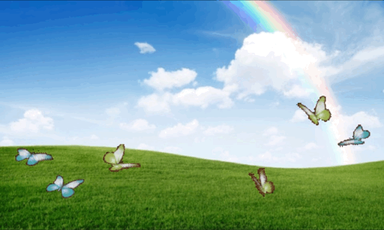
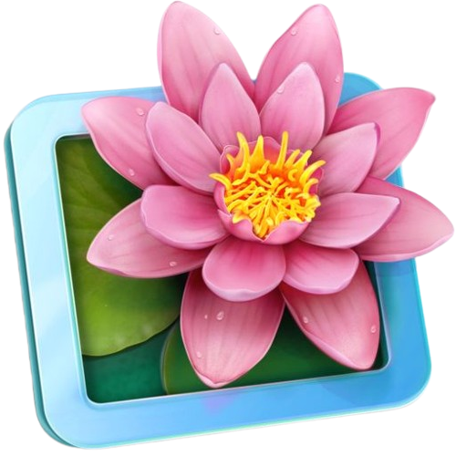
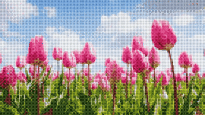

 

 

  
   
  

  
<b>Desenvolvedora Full-Stack | UX/UI Designer | AI Explorer</b>

  
<i>Construindo interfaces minimalistas de alto contraste e arquiteturas robustas no back-end. Atualmente pesquisando a composição lógica por trás da Inteligência Artificial.</i>

<!-- Links de Contacto estilo Badges -->

  
  
  

 

  

 

### 🪟 Tecnologias e Ecossistema

  <!-- Ícones com alinhamento limpo -->
  
  
  
  
  

 

 

  

 

### 📈 Universo de Dados e Analytics

  <!-- Topo: Painéis Lado a Lado (Estrutura inspirada no perfil Benjamin) -->
  <table align="center" width="100%">
    <tr>
      <td width="50%" align="center">
        <!-- Estatísticas Gerais -->
        
      </td>
      <td width="50%" align="center">
        <!-- Estatísticas de Streak -->
        
      </td>
    </tr>
  </table>

  <!-- Meio: Stack Analytics (Inspirado no Activity Pulse / Stack do perfil ACE) -->
  

    

  <!-- Fundo: Gráfico de Linha de Contribuições com preenchimento de área -->
  

 

  <!-- GIF das Tulipas em Pixel Art no rodapé -->
  

