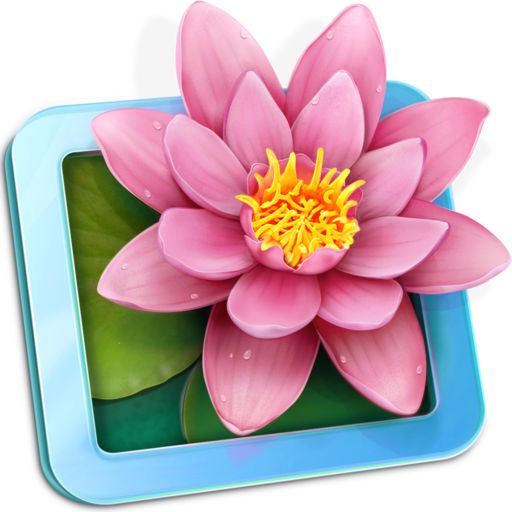

<!-- Banner Principal Frutiger Aero -->

  
  
    
  
  
   
  

  

    
  

  
  <!-- Redes Sociais com fundo escuro e logotipos nas cores da sua paleta -->
  
  
  

 

  

 

---

## 🫧 Sobre Mim

<table>
  <tr>
    <td width="60%" valign="top">
      Olá! Sou a Kelryana, <b>Desenvolvedora Full-Stack | UX/UI Designer | AI Explorer</b>.  
      🌱 <b>O que eu faço:</b> Construo interfaces minimalistas de alto contraste e arquiteturas robustas no back-end.  
      ✨ <b>Pesquisa Atual:</b> Estou aprofundando os meus estudos na composição lógica por trás da Inteligência Artificial.  
      🎯 <b>Missão:</b> Unir estética imersiva (Frutiger Aero, Glassmorphism) com usabilidade e funcionalidade avançada.
    </td>
    <td width="40%" align="center">
      <!-- GIF das Tulipas encaixado na tabela de apresentação -->
      
    </td>
  </tr>
</table>

 

## 🌿 Tecnologias e Ecossistema

  <!-- Badges de tecnologias mesclando o estilo do seu modelo com o nosso tema escuro/neon suave -->
  
  
  
  
  

 

---

## 📊 Universo de Dados e Analytics

  <!-- Estatísticas lado a lado dimensionadas por 'height' (em). Remove o bug das tabelas!
       Fundo transparente com a paleta Rosa (F47090), Azul (58B2DC), Amarelo (F1E05A) e Cinza (C9D1D9) -->
  
  
  
  
  
   
  
  

 

## 🌐 Gráfico de Atividade

  <!-- Gráfico de contribuição (Linha rosa, preenchimento de área) -->
  

 

---

  
    
  <i>"Design não é apenas o que parece e o que se sente. Design é como funciona."</i> 
  

